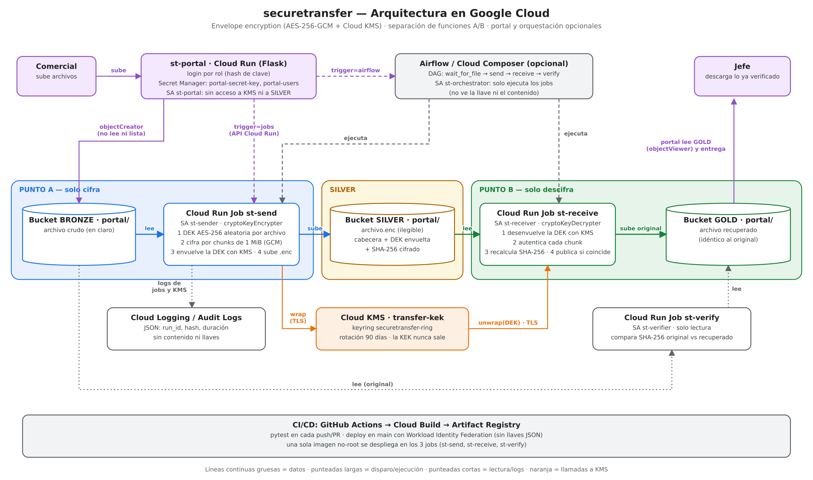

# securetransfer — Cifrado y transferencia de archivos en GCP

Cifra un archivo en un **punto A** (capa *bronze*), lo transfiere por una capa intermedia (*silver*, cifrada) y lo descifra en un **punto B** (capa *gold*),
verificando que el archivo recuperado es **idéntico** al original. Desplegado en Google Cloud
(Cloud KMS + Cloud Storage + Cloud Run Jobs). Reutilizable con cualquier archivo **sin modificar el código**.

```
 BRONZE (punto A)                SILVER                       GOLD (punto B)
 gs://…-bronze/portal/ ─cifrar─►  gs://…-silver/portal/ ─descifrar─►  gs://…-gold/portal/
 Job st-send                     archivo .enc                    Job st-receive
 SA st-sender                                                    SA st-receiver
 (solo CIFRA con KMS)                                            (solo DESCIFRA con KMS)
        └──────────────── Cloud KMS: la llave maestra (KEK) nunca sale de KMS ────────────────┘
```

## Arquitectura medallion (Bronze / Silver / Gold)

Cada capa es un bucket del proyecto y **todo lo de la interfaz vive en la carpeta `portal/` de cada capa**:

| Capa | Bucket | Qué contiene | Quién escribe | Quién lee |
|---|---|---|---|---|
| **Bronze** | `<proyecto>-bronze/portal/<run_id>/<archivo>` | El archivo **crudo**, tal como lo sube la interfaz | `st-portal` (solo crear) | `st-send` y `st-verify` |
| **Silver** | `<proyecto>-silver/portal/<run_id>/<archivo>.enc` | El archivo **cifrado** (AES-256-GCM, DEK envuelta con KMS) | `st-send` | `st-receive` |
| **Gold** | `<proyecto>-gold/portal/<run_id>/<archivo>` | El archivo **recuperado y verificado**, listo para consumir | `st-receive` | `st-verify` y `st-portal` (el jefe descarga) |

**Airflow y los Cloud Run Jobs solo leen y escriben dentro de `portal/`.** Se garantiza en tres niveles:

1. **Rutas**: el DAG y el portal calculan siempre `gs://<proyecto>-<capa>/portal/...` (`dags/securetransfer_paths.py`, `portal/trigger.py`).
   El parámetro `object` del DAG es relativo a `portal/`: aunque se manipule, el flujo antepone la carpeta.
2. **IAM**: los permisos de lectura y creación de objetos son **condicionales por prefijo**
   (`resource.name.startsWith("projects/_/buckets/<bucket>/objects/portal/")`). Ver `folder_condition()` en `deploy/gcp.py`.
3. **Aplicación**: los jobs se despliegan con `SECXFER_ALLOWED_PREFIX=portal/` y `securetransfer/storage.py` se niega a leer o escribir
   cualquier otro objeto de GCS (segunda barrera, probada sin necesidad de GCP).

Dos aclaraciones honestas:

- **El listado no se puede acotar por carpeta con IAM** (`storage.objects.list` es un permiso de bucket; Google documenta que `resource.name`
  no lo restringe). Por eso el sensor de Airflow (en bronze) y el portal (en gold) tienen `legacyBucketReader` sobre el bucket: ven *nombres*
  de objeto, no contenido. Como todo el flujo escribe solo en `portal/`, no hay nada más que listar.
- **El mapeo a medallion es por analogía.** En un lakehouse, *silver* suele ser dato limpio y conformado; aquí es la copia **cifrada** en
  tránsito. Si más adelante se añaden transformaciones de calidad (p. ej. el reto 4), irían entre bronze y gold, no en este flujo.

**Migración desde los buckets `-origen`, `-transito` y `-destino`:** un bucket de GCS no se puede renombrar. `python deploy/gcp.py infra`
crea los tres nuevos (idempotente); después vuelva a ejecutar `build-deploy`, `deploy/portal.py up` y, si usa Composer, `deploy/composer.py wire`.
Los buckets antiguos quedan sin uso: bórrelos cuando confirme que no necesita su contenido.

## Arquitectura



*(Versión vectorial: [`docs/arquitectura.svg`](docs/arquitectura.svg).)*

Cómo leerlo:

- **Flujo de datos (línea gruesa, al centro):** BRONZE → `st-send` → SILVER (`.enc`) → `st-receive` → GOLD (todo bajo `portal/`). Son tres buckets y tres Cloud Run Jobs con la misma imagen pero **identidades distintas**.
- **Separación de funciones:** `st-sender` solo cifra (`cryptoKeyEncrypter`), `st-receiver` solo descifra (`cryptoKeyDecrypter`) y `st-verifier` solo lee. Quien envía no puede leer lo que envió.
- **Cloud KMS (naranja):** la KEK nunca sale de KMS; los jobs solo envuelven/desenvuelven la DEK de cada archivo por TLS.
- **Portal y Airflow (arriba, opcionales):** no cifran nada; el portal deja el archivo en BRONZE (solo crear) y lee GOLD (solo leer), y Airflow solo *ejecuta* los jobs en orden. El portal inicia el flujo directamente (`trigger=jobs`) o vía Airflow (`trigger=airflow`).
- **Verificación independiente:** `st-verify` compara el SHA-256 del original y del recuperado, además de la verificación interna que hace `st-receive`.
- **Observabilidad y CI/CD (abajo):** logs JSON sin contenido ni llaves; GitHub Actions construye una sola imagen y despliega los 3 jobs con Workload Identity Federation.

## Cómo funciona (envelope encryption)

1. Se genera una **llave de datos (DEK)** AES-256 aleatoria **por archivo**.
2. El archivo se cifra en streaming con **AES-256-GCM** (chunks de 1 MiB, memoria constante).
3. La DEK se **envuelve con Cloud KMS** (KEK) y se guarda en la cabecera del `.enc`. La DEK en claro nunca se escribe a disco.
4. El SHA-256 y el tamaño del original van **cifrados** dentro de la cabecera. Al descifrar se recalculan y se comparan;
   si algo no cuadra, **no se entrega ningún archivo** (el resultado parcial se elimina).
5. Cada chunk autentica el número de chunk, si es el último y la cabecera completa → detecta alteración, reordenamiento,
   truncamiento y adiciones.

## Estructura

```
securetransfer/        código (crypto, keys, storage, pipeline, cli, logging)
tests/                 pruebas (cripto, manipulación, KMS simulado, CLI, despliegue en dry-run, DAG)
deploy/gcp.py          despliegue y demo en GCP, en Python (infra · build-deploy · demo · tamper · grant-orchestrator · dag-import)
portal/                portal web (Flask): el comercial sube y el jefe descarga, conectado al flujo (ver "Portal web")
deploy/portal.py       despliegue del portal en Cloud Run (secrets · infra · deploy · up · url)
dags/                  DAG de Airflow/Composer: st-send → st-receive → st-verify → registro de auditoría en BigQuery
Dockerfile             imagen no-root
docs/arquitectura.png   diagrama de arquitectura (fuente SVG: docs/arquitectura.svg)
docs/SUSTENTACION.md   alternativas, preguntas probables y guion de 2 minutos
```

## Prueba local (sin GCP, solo para desarrollo)

```bash
python -m venv .venv && source .venv/bin/activate
pip install -r requirements-dev.txt
python -m pytest                                   # pruebas

export SECXFER_KEY_PROVIDER=local
export SECXFER_LOCAL_KEY=$(python -m securetransfer gen-local-key)   # SOLO pruebas
python -m securetransfer send    --source ejemplo.csv --destination silver/
python -m securetransfer receive --source silver/ejemplo.csv.enc --destination gold/
python -m securetransfer verify  --original ejemplo.csv --recovered gold/ejemplo.csv
```

## Despliegue en GCP (≈15 min)

Requisitos: un proyecto con facturación, `gcloud` autenticado (Cloud Shell sirve) y Python 3.10+. El módulo de despliegue
solo usa la biblioteca estándar: invoca la CLI `gcloud` como subproceso, sin shell. Con `--dry-run` imprime los comandos
sin ejecutarlos, útil para revisarlos antes.

```bash
git clone <su-repo> && cd securetransfer
export PROJECT_ID=<su-proyecto>  REGION=us-east1

python deploy/gcp.py --dry-run infra   # (opcional) ver los comandos sin ejecutarlos
python deploy/gcp.py infra             # buckets, KMS (rotación 90 d), cuentas de servicio y permisos mínimos
python deploy/gcp.py build-deploy      # construye la imagen y crea los dos Cloud Run Jobs
```

### Demo (cualquier archivo, mismo código)

```bash
python deploy/gcp.py demo   ruta/al/archivo   # bronze -> silver -> gold + verificación independiente (hashlib)
python deploy/gcp.py tamper ruta/al/archivo   # altera 1 byte en silver: B lo rechaza y no publica nada
```

Para otro archivo basta repetir el comando con otra ruta. Cada ejecución usa una carpeta única en los buckets.


## Orquestación con Airflow / Cloud Composer 

Airflow **orquesta**, Cloud Run **ejecuta**. El DAG `securetransfer_cloud_run` espera el archivo en BRONZE/portal y dispara en orden
`st-send` → `st-receive` → `st-verify`. Cada job conserva su identidad (cifra / descifra / solo lee); la cuenta del entorno de
Airflow solo puede *ejecutar* los jobs, nunca ve la llave ni el contenido.

**Versión de Airflow: 2.x.** El DAG usa los imports de `airflow.models` y no es compatible con Airflow 3. `deploy/composer.py create`
usa por defecto la imagen `composer-3-airflow-2` (Composer 3 + última Airflow 2.x); `gcloud` no lista versiones, por eso se usa un alias.

```bash
python deploy/composer.py create --project-number <número>   # entorno de Composer (~25 min); luego: status, wire, trigger
python deploy/gcp.py build-deploy                      # (re)despliega los 3 jobs (usan --container job)
python deploy/gcp.py grant-orchestrator --service-account <cuenta-de-composer>@<proyecto>.iam.gserviceaccount.com
python deploy/gcp.py dag-import --environment <entorno-composer> --region <region>
```

**Permiso necesario para que Airflow espere a los jobs:** además de ejecutarlos, el operador consulta la operación de Cloud Run
(`run.operations.get`). `wire` concede `roles/run.viewer` (solo lectura) a `st-orchestrator` a nivel de proyecto. Sin él, la tarea `send`
falla con `PERMISSION_DENIED ... run.operations.get` aunque el job sí se haya lanzado.

Disparo (UI de Airflow: *Trigger DAG w/ config*): `{"project_id": "<proyecto>", "object": "clientes.csv"}` (se lee de `gs://<proyecto>-bronze/portal/clientes.csv`).
Cada ejecución usa su propia carpeta (`run_id`) en silver/portal y gold/portal, así reejecutar nunca choca con la regla de no-sobrescritura.

### Auditoría en BigQuery

Cada ejecución del DAG (exitosa **o fallida**) deja una fila en `<proyecto>.auditoria.ejecuciones_airflow`. Lo hace la última
tarea, `registrar_ejecucion`, con `trigger_rule=all_done`: corre aunque `send`, `receive` o `verify` hayan fallado. Si el flujo
falló, la tarea registra primero y **después** falla, para que Airflow no marque la corrida como exitosa.

| Columna | Qué guarda |
|---|---|
| `id`, `nombre_dag`, `run_id` | fila única (uuid), DAG y corrida. En el portal el `run_id` es `portal-<fecha>-<usuario>-<id>`: enlaza con el recibo |
| `tipo_ejecucion`, `fecha_logica` | `manual`/`scheduled` y el periodo que representa |
| `fecha_hora_ejecucion`, `fecha_hora_fin`, `duracion_segundos` | inicio, fin y duración |
| `estado_ejecucion` | `EXITOSO` / `FALLIDO` (también si una tarea se saltó por una falla anterior) |
| `tarea_fallida`, `url_log` | primera tarea que falló y el enlace a su log en Airflow |

Ejemplo de consulta:

```sql
SELECT run_id, tarea_fallida, url_log
FROM `<proyecto>.auditoria.ejecuciones_airflow`
WHERE estado_ejecucion = 'FALLIDO'
ORDER BY fecha_hora_fin DESC
LIMIT 10;
```

- **Se crea solo:** `python deploy/composer.py wire` crea el dataset y la tabla (`IF NOT EXISTS`, así que no toca una tabla que ya exista con estas
  columnas, p. ej. la de otro DAG: `nombre_dag` los distingue), da permisos y sube el DAG. Solo la tabla: `python deploy/composer.py audit-table`.
- **Mínimo privilegio:** la cuenta de Airflow (`st-orchestrator`) recibe `bigquery.jobUser` en el proyecto (solo lanzar consultas) y `bigquery.dataEditor`
  **únicamente sobre esa tabla**. No ve otros datos de BigQuery. `dataEditor` también permite borrar filas: si el banco exige auditoría *append-only*,
  el siguiente paso es un rol personalizado con solo `bigquery.tables.updateData` y `getData`.
- **Qué NO guarda:** nada del contenido de los archivos, ni hashes ni llaves; solo identificadores y estados. Los valores van como parámetros del INSERT, nunca pegados en el SQL.
- **Región:** la tabla se crea en la región del despliegue (`us-east1`) y el DAG usa el parámetro `region` para el cliente de BigQuery: deben coincidir.


## Portal web: el comercial sube, el jefe descarga

Una pantalla muy simple conectada a **este mismo flujo**: el portal no cifra nada, solo entrega el archivo al punto A y recoge el
resultado del punto B.

```
 comercial ─► PORTAL ─► BRONZE ─ st-send ─► SILVER ─ st-receive ─► GOLD ─ st-verify
  (sube)    st-portal   solo crear   cifra (KMS)    .enc      descifra       solo leer ◄─ PORTAL ◄─ jefe (descarga)
```

| Rol | Puede | No puede |
|---|---|---|
| `comercial` | Subir un archivo y recibir un recibo (referencia + SHA-256) | Ver la lista ni descargar |
| `jefe` | Ver y descargar lo que **ya pasó** por el cifrado y la verificación | Subir |

Ejemplo: `maria` (comercial) sube `oferta.pdf` → se guarda en `gs://<proyecto>-bronze/portal/portal-20261121T195500Z-maria-a1b2c3/oferta.pdf`
→ el flujo lo cifra, lo descifra y lo deja en `gs://<proyecto>-gold/portal/portal-20261121T195500Z-maria-a1b2c3/oferta.pdf` →
`carlos` (jefe) lo ve en su lista y lo descarga. La carpeta `portal-<fecha>-<usuario>-<id>` es el `run_id` del flujo: sirve de
trazabilidad y evita chocar con la regla de no-sobrescritura.

### Desplegar en Cloud Run (4 comandos)

Requisito: ya corriste `python deploy/gcp.py infra` y `python deploy/gcp.py build-deploy` (buckets, KMS y los 3 jobs).

```bash
python -m portal.manage_users add maria comercial          # crea users.json (hash de la clave, nunca la clave)
python -m portal.manage_users add carlos jefe
python deploy/portal.py secrets --users-file users.json    # los sube a Secret Manager (por stdin)
python deploy/portal.py up --trigger jobs                  # cuenta st-portal + imagen + servicio; imprime la URL
```

Pruébelo antes con `python deploy/portal.py --dry-run up` (imprime los comandos sin ejecutarlos). Cada subcomando también se puede
correr por separado (`infra`, `deploy`, `url`).

**Dos formas de poner en marcha el flujo** (`--trigger`):

| | `jobs` (por defecto) | `airflow` |
|---|---|---|
| Cómo | El portal ejecuta `st-send → st-receive → st-verify` por la API de Cloud Run | El portal dispara el DAG `securetransfer_cloud_run` por la API REST de Airflow |
| Necesita Composer | No | Sí (entorno en RUNNING y DAG importado) |
| Historial y reintentos | Solo logs | Los de Airflow |
| Servicio | 1 instancia siempre encendida (`--no-cpu-throttling`): el flujo corre en un hilo de fondo | Sin estado: escala normal |
| Permisos extra de `st-portal` | Ejecutar los 3 jobs + `roles/run.viewer` | `roles/composer.user` |

Con Airflow: `python deploy/portal.py up --trigger airflow` (la URL de Airflow se consulta a Composer; o `--airflow-uri`).

### Permisos de `st-portal` (mínimo privilegio)

- **BRONZE**: `objectCreator` solo en `portal/` → puede crear, **no leer ni listar** lo que subió. **GOLD**: `objectViewer` solo en `portal/` + `legacyBucketReader` (listar nombres) → solo leer.
- **Sin acceso a SILVER ni a la llave KMS**: el portal no puede descifrar nada por su cuenta; solo ve lo que el flujo ya entregó.
- Solo lee sus dos secretos (`portal-secret-key`, `portal-users`). Las pruebas fijan estos permisos exactos.
- El listado solo muestra carpetas `portal-…`: las demos (`demo-…`) y corridas del DAG que también viven en `portal/` no se exponen.

### Probar el portal completo en su máquina (sin GCP)

Corre el flujo **real** de `securetransfer` con llave local sobre carpetas que replican los buckets (`dev-flow/bronze/portal`, `silver/portal`, `gold/portal`):

```bash
pip install -r requirements-dev.txt
python -m portal.manage_users add maria comercial && python -m portal.manage_users add carlos jefe
export PORTAL_TRIGGER=local COOKIE_SECURE=0 SECXFER_LOCAL_KEY=$(python -m securetransfer gen-local-key)
python -m portal.app            # http://127.0.0.1:8080
```

### Variables del portal

| Variable | Descripción | Por defecto |
|---|---|---|
| `PORTAL_STORE` | `gcs` (producción) o `local` | `local` |
| `PORTAL_TRIGGER` | `jobs`, `airflow`, `local` o `none` | `none` |
| `PROJECT_ID`, `REGION` | Proyecto y región del flujo | — / `us-east1` |
| `AIRFLOW_URI`, `AIRFLOW_DAG_ID` | Solo modo `airflow` | — / `securetransfer_cloud_run` |
| `SECRET_KEY`, `USERS_JSON` | Llegan de Secret Manager | — |
| `MAX_UPLOAD_MB`, `ALLOWED_EXTENSIONS`, `SESSION_MINUTES`, `COOKIE_SECURE` | Límites y sesión | 25 · pdf,doc,docx,xls,xlsx,csv,txt,png,jpg,jpeg · 30 · 1 |
